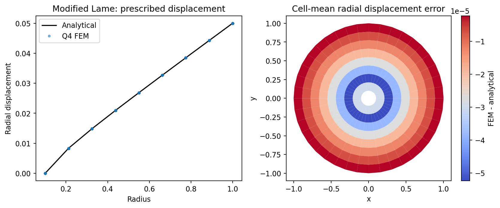
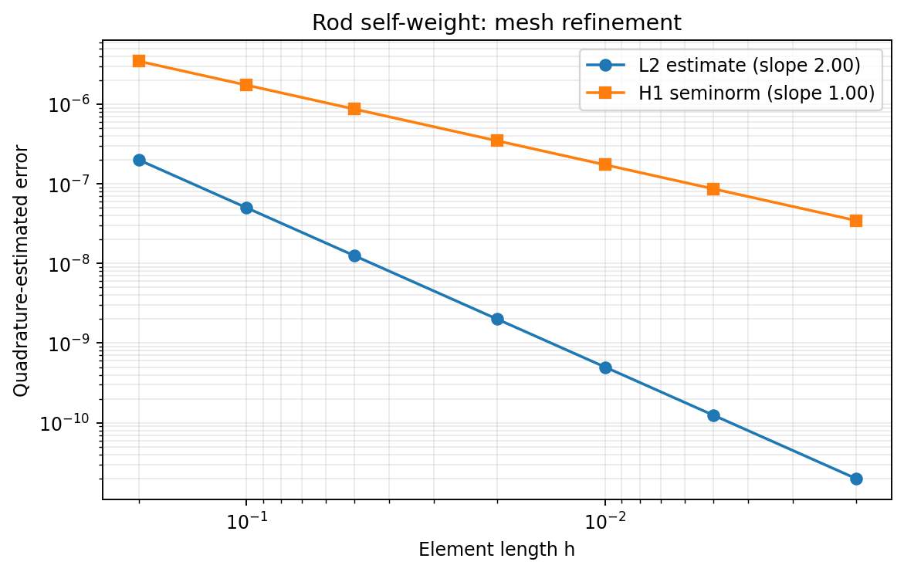
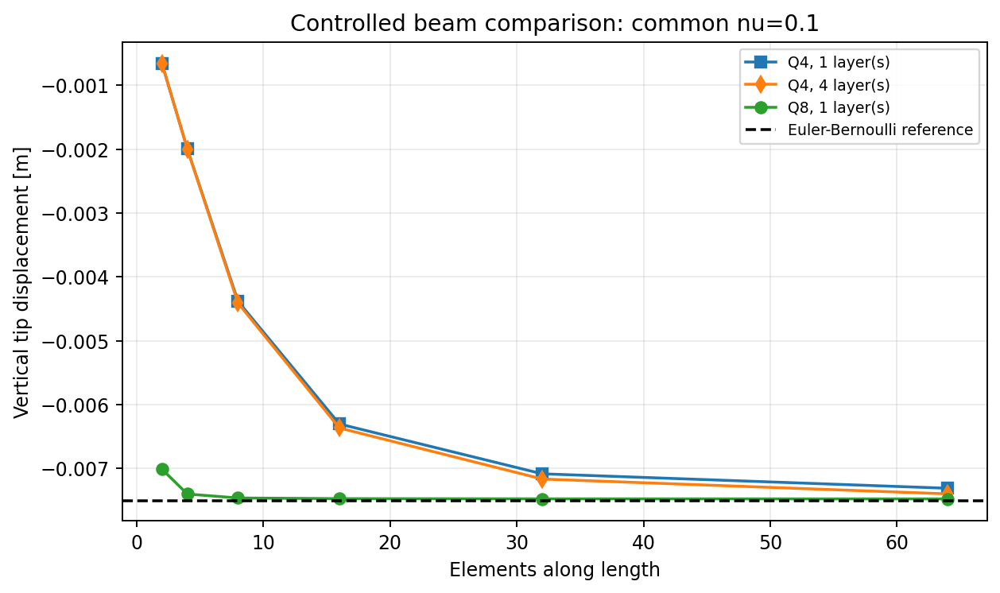

# Finite Element Linear Elasticity

A Python elasticity solver examined through analytical verification, mesh refinement, and element behavior.



A finite-element solution is only useful if the numerical implementation can be trusted. In this project, I built a Python solver for linearized elasticity and examined whether the element calculations, assembly, boundary conditions, stress recovery, and resulting fields behaved consistently under analytical verification and mesh refinement.

The implementation covers one-dimensional rods and two-dimensional isotropic elasticity, connecting element stiffness and load integration to global assembly, displacement constraints, solution of the linear system, and post-processing.

I used analytical solutions and mesh refinement to check the implementation, then moved to bending, near-incompressibility, and stress concentration. This progression made the project both a solver implementation and a study of how element choice, mesh resolution, and stress evaluation affect the numerical response.

## From implementation to verification

The self-weight rod provides an initial analytical check of displacement and stress. Refining its L2 mesh makes it possible to examine displacement error and gradient error separately, rather than relying on visual agreement alone.

The cantilever study compares Q4 and Q8 elements under the same material and loading conditions. It examines the excessive stiffness associated with Q4 bending behavior and the effects of refinement along the beam and through its depth.

The modified Lamé cylinder extends analytical verification to two dimensions through prescribed radial displacements, displacement-error evaluation, and mesh refinement. Cook’s membrane then examines Q4 mesh dependence, recovered stress trace, and sensitivity as Poisson’s ratio approaches the incompressible limit.

The final study uses the solver to examine how stress concentration changes as the hole-to-plate-height ratio varies, providing a final test of stress recovery and geometric sensitivity.

## What the results show

The modified Lamé figure above checks the two-dimensional displacement field against an analytical solution. The left panel compares radial displacement; the right maps signed radial displacement error averaged over each element’s nodes.



For the rod, the quadrature-estimated L2 displacement error decreases at approximately second order, while the H1 seminorm decreases at first order. These measured slopes provide a quantitative refinement check for the linear elements.



In the controlled bending comparison, Q8 approaches the beam reference with relatively few elements along the length. Q4 is substantially stiffer on coarse meshes and improves with refinement. Additional layers through the depth give a smaller improvement. Every curve uses Poisson’s ratio 0.1; the dashed Euler–Bernoulli curve is an engineering reference for the two-dimensional elasticity calculation.

## Implementation

The solver uses isoparametric elements, Gaussian quadrature, and partitioned assembly of free and prescribed degrees of freedom. It handles body forces and nodal loads, solves the resulting linear system, and reconstructs nodal displacements. Stress recovery evaluates L2 rod stresses at Gauss points or element endpoints, with optional nodal averaging; the two-dimensional recovery routine averages Q4 corner stresses.

The examples generate their meshes in Python. NumPy, SciPy, SymPy, and Matplotlib support the numerical calculations, shape-function derivatives, and visualization.

- [solver.py](src/fem/solver.py) — global elasticity driver.
- [elements.py](src/fem/elements.py) — shape functions, mapping, and element matrices.
- [quadrature.py](src/fem/quadrature.py) — integration rules.
- [assembly.py](src/fem/assembly.py) — global stiffness and load assembly.
- [boundary_conditions.py](src/fem/boundary_conditions.py) — equation numbering, constraints, and point loads.
- [postprocessing.py](src/fem/postprocessing.py) — displacement reconstruction, error estimates, and energy.
- [stress_recovery.py](src/fem/stress_recovery.py) — rod and Q4 stress evaluation.

## Running the examples

```bash
git clone https://github.com/nafeezatajenifuja/finite-element-linear-elasticity.git
cd finite-element-linear-elasticity
python -m pip install -r requirements.txt -e .
python -m examples.rod_self_weight
```

Start with the rod to examine analytical agreement, convergence, and stress recovery. The remaining studies are available in [examples/](examples/), with reproduction settings and full-study commands in the [numerical notes](docs/numerical_notes.md).

## Background

I developed the original implementation for CIVE 7336 Finite Element Methods at the University of Houston. Public release of my implementation was permitted by the course instructor. Detailed numerical notes, archived results, and attribution for course reference material are retained in the project documentation.
