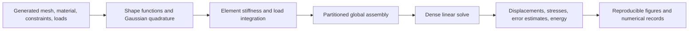
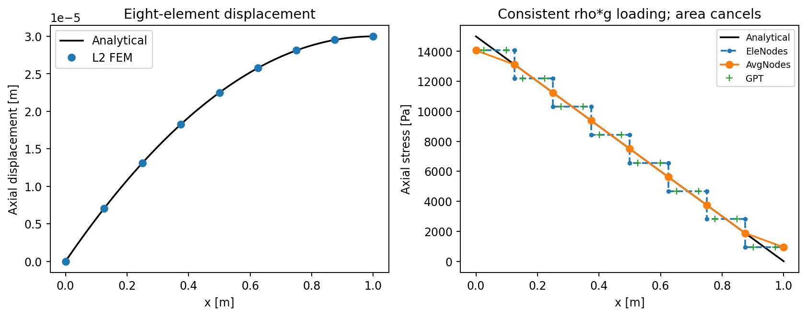

# Finite Element Linear Elasticity Solver

A student-authored Python implementation of Galerkin finite elements for quasi-static linearized elasticity, with analytical checks, mesh studies, and stress recovery.

## Motivation and contribution

This project connects the elasticity weak form to executable numerical software: element integration, global assembly, displacement constraints, a linear solve, and interpretation of the resulting fields. It was developed to understand and implement standard finite-element methods rather than to introduce a new formulation.

The student's contribution is the Python implementation and its numerical experiments. The course supplied problem definitions, formulations, MATLAB references, and some input files. Those contributions are credited separately; the supplied source files and teaching materials are excluded from this release. See the [ownership audit](docs/ownership_audit.md).

## Governing problems

The maintained examples solve one-dimensional axial deformation and two-dimensional isotropic small-strain elasticity:

```text
-div(sigma) = b
epsilon = (grad(u) + grad(u).T) / 2
sigma = lambda * tr(epsilon) * I + 2 * mu * epsilon
```

Prescribed displacements are imposed by partitioning free and constrained degrees of freedom. Loads include body forces and nodal point loads; the examples convert constant tractions on uniformly spaced straight edges to equivalent nodal loads. Two-dimensional calculations use unit thickness. Effective Lamé constants distinguish plane stress in the cylinder example from plane strain in the beam and Cook examples.

## Numerical formulation and elements

- **L2:** two-node linear rod, with two-point Gauss-Legendre integration by default.
- **Q4:** four-node bilinear quadrilateral, with a 2×2 Gauss rule by default.
- **Q8:** eight-node serendipity quadrilateral, with the original fixed 3×3 Gauss rule.

The original shape-function polynomials and node ordering are retained. SymPy differentiates the polynomials; numerical evaluators and quadrature-point data are cached. Isoparametric mapping uses `J = x.T @ dN_dxi` and `dN_dx = dN_dxi @ inv(J)`. Inverted or degenerate elements are rejected.

Element stiffness uses the student's original volumetric and shear terms expressed with Kronecker products and a transpose permutation. The global solver retains dense free/free and free/prescribed matrices and solves

```text
K_FF u_F = f_F - K_FP u_P
```

Connectivity, constraint node IDs, and point-load component IDs remain **one-based**, matching the original code. Q4/Q8 corner ordering is bottom-left, bottom-right, top-right, top-left; Q8 adds bottom, right, top, and left midside nodes.

## Code architecture



`fem.solve` is the global driver. The package separates assembly, element calculations, material constants, boundary conditions, mesh generation, postprocessing, and stress recovery. The [methodology](docs/methodology.md) maps these components to the original files and explains the approved corrections.

## Verification strategy and convergence studies

| Experiment | Comparison or study | Interpretation |
| --- | --- | --- |
| Rod self-weight | Analytical displacement and stress; seven meshes with 5–500 L2 elements | Quadrature-estimated displacement L2 error and H1 seminorm show slopes approximately 2 and 1. |
| Q4/Q8 cantilever | One- and four-layer Q4 meshes; one-layer Q8; 2–64 elements along the beam | The cleaned comparison uses the same Poisson ratio for every curve. Euler-Bernoulli theory is an engineering reference, not an exact solution of the 2D plane-strain problem. |
| Modified Lamé cylinder | Prescribed inner/outer displacements; analytical radial field; energy and L2 refinement | The full original mesh sequence gives an L2 fitted slope near 1.7438. This is a measured finite-mesh result, not a universal convergence rate. |
| Cook's membrane | Q4 refinement and Poisson-ratio sweep, including near-incompressibility; recovered stress trace | A sensitivity study without an analytical Cook solution or an independent reference solver. Strong mesh dependence remains. |
| Plate with hole | Six nominal diameter/height ratios on the original 81×41 nodal grid | Exploratory stress-concentration study with stepwise geometry and a legacy stress-sampling heuristic; not a validated circular-hole benchmark. |

Automated checks cover interpolation at nodes, partition of unity, derivative sums and finite differences, quadrature moments, exact rod element matrices, rigid-body modes, an affine displacement patch, nonzero Dirichlet conditions, point-load accumulation, analytical refinement, and corrected shear stress. Additional tests compare the maintained shape functions, element matrices, and global solutions directly with the archived student implementation.

The reproduction script compares new results with saved outputs from the original notebook, using tolerances appropriate to their printed precision. The original report's rod error table differs from the notebook; it is not silently substituted as a matching reference. Detailed numerical evidence is saved in [reproduction_results.json](docs/reproduction_results.json).

## Representative results


*Rod self-weight: the same quadrature estimator used by the course implementation shows the expected L2 and H1-seminorm slopes for this problem.*


*Corrected comparison: every curve uses ν = 0.1. The archived one-layer Q4 curve used a different ν, so this figure is not an unchanged historical output.*


*Displacement-driven modified Lamé problem: radial displacement and the cell-mean radial error. The plot uses the actual annular elements, preserving the empty central hole.*

## Stress recovery

For the L2 rod, stresses can be evaluated at Gauss points, retained separately at element endpoints, or averaged at shared nodes. For Q4 elasticity, stresses are evaluated at element corners and averaged over adjacent elements. The Cook example includes the out-of-plane stress in its plane-strain trace.



These are direct/averaged recovery procedures, not a superconvergent patch-recovery method. The maintained tensor recovery uses `sigma_xy = mu * gamma_xy`, correcting the archived notebook's extra factor of two. The rod stress example also uses body force `rho*g` consistently; its original extra area factor is retained only in the archive.

## Installation

Use Python **3.11 or newer**. Local validation used **Python 3.13.5** with the versions pinned in `requirements.txt`. The verified direct numerical dependencies are **NumPy, SciPy, Matplotlib, and SymPy**. Tests use standard-library `unittest`; no Jupyter installation, course mesh, or MATLAB installation is required for the maintained examples.

```bash
git clone https://github.com/nafeezatajenifuja/finite-element-linear-elasticity.git
cd finite-element-linear-elasticity
python -m venv .venv
```

Activate in PowerShell with `.\.venv\Scripts\Activate.ps1`, or on macOS/Linux with `source .venv/bin/activate`, then run:

```bash
python -m pip install -r requirements.txt -e .
python -m unittest discover -s tests -v
python scripts/reproduce.py
```

The default reproduction uses smaller cylinder and Cook meshes. The SCF example always retains its original 81×41 nodal grid because the archived coarser demo can select duplicate restraints. To reproduce the complete original mesh sequences and the Cook 64×64 Poisson sweep:

```bash
python scripts/reproduce.py --full --output results/full_reproduction.json
```

Full reproduction retains dense matrices and can require several gigabytes of memory. Results are written to `results/`, and plots to `figures/`. Examples are deterministic; the randomized test points use a fixed local seed. The verification record includes interpreter/library versions and the BLAS thread setting. Cross-platform bitwise identity is not claimed.

## Example usage

Run any experiment separately from the repository root:

```bash
python -m examples.rod_self_weight
python -m examples.cantilever_q4_q8
python -m examples.lame_cylinder --full
python -m examples.cooks_membrane --full
python -m examples.stress_concentration
```

The package also accepts user-created meshes and inputs:

```python
from fem import Material, solve
from fem.meshes import rod_mesh

mesh, constraints = rod_mesh(elements=8, length=1.0)
material = Material.from_young_poisson(young=250e6, poisson=0.0)
u = solve(mesh, material, constraints, body_force=[1500.0 * 10.0])
```

For a custom mesh, construct `fem.Mesh(coordinates, connectivity, element)` and supply rows `[node, component, value]` for displacement constraints and point loads. See [input substitution](docs/methodology.md#replacing-supplied-inputs) for the array conventions and limits.

## Repository structure

```text
.
├── README.md
├── requirements.txt
├── pyproject.toml
├── .gitignore
├── .gitattributes
├── .github/workflows/verify.yml
├── src/fem/
│   ├── assembly.py
│   ├── elements.py
│   ├── quadrature.py
│   ├── elasticity.py
│   ├── boundary_conditions.py
│   ├── postprocessing.py
│   ├── stress_recovery.py
│   ├── mesh.py
│   ├── meshes.py
│   ├── solver.py
│   └── __init__.py
├── examples/                    # five experiments plus shared output helpers
├── tests/                       # formulation, convergence, and archive comparisons
├── scripts/reproduce.py
├── figures/
│   ├── convergence/
│   ├── elasticity/
│   └── stress_recovery/
├── docs/
│   ├── methodology.md
│   ├── ownership_audit.md
│   ├── ownership_audit.csv
│   ├── reproduction_results.json
│   └── portfolio.md
└── archive/
    ├── README.md
    ├── manifest.json
    └── original_course_structure/FEM_LE/
        └── original student Python modules and final notebook
```

## Limitations

This is a graduate course solver, not a production engineering package. It retains dense assembly and solution; the maintained release focuses on L2/Q4/Q8 and the demonstrated 1D/2D problems. The archived interpolation library contains additional element types, but this release does not claim equivalent elasticity validation for them.

There is no nonlinear material law, geometric nonlinearity, dynamics, contact, adaptivity, mixed displacement-pressure formulation, or locking correction. Q4 results can remain mesh-sensitive in bending and near-incompressible problems. Error norms are quadrature estimates, and nodal averaging does not certify stress accuracy. The SCF geometry/sampling limits and the invalid restraints in its archived coarse demo are documented explicitly. Large computed displacements are not a validation of a large-deformation model. No runtime speedup, general accuracy benchmark, or production-readiness claim is made.

## Course provenance

Developed as the CIVE 7336 Finite Element Methods course project at the University of Houston. Public release of the student's project implementation was permitted by the course instructor.

The author confirmed authorship of the Python implementation and reported the instructor's verbal permission. Course formulations and MATLAB references are credited to **Professor Kalyana B. Nakshatrala**. In particular, the student's `TMatrix` and 1D stress-recovery organization have identifiable reference counterparts. The public archive preserves the student Python files, not the instructor's MATLAB files. Instructor handouts, supplied meshes/tables, lecture materials, the other-named notebook, and reports reproducing course diagrams are excluded.

Original student code and final-notebook outputs remain unchanged in `archive/`; SHA-256 hashes document their provenance. The current code contains the three author-approved numerical corrections and records the additional coarse-SCF restraint limitation. The original report disclosed AI assistance; this later reorganization and verification were also AI-assisted. No license has been added.
